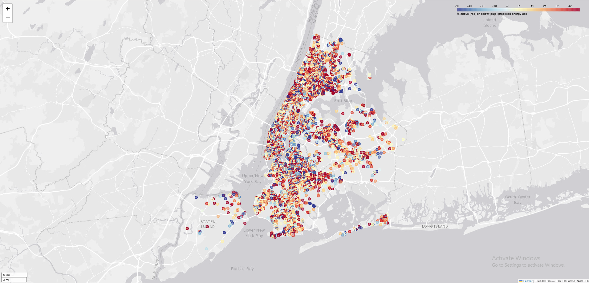

# Predicting Apartment Building Energy Use in New York City

A model that predicts how much energy NYC apartment buildings should use from public data, and a map of the buildings that use far more than predicted: likely retrofit candidates.

**[View the interactive map](https://Dcerty18.github.io/nyc-building-energy/)**



## Key results

- **Retrofit leads:** 1,855 buildings (13%) use at least 50% more energy than similar buildings, spread evenly across boroughs (11–14%).
- **Ranking low performers:** of the 500 buildings the classifier ranks highest-risk, 61% are true low performers (worst 25% by energy use intensity), versus 25% chosen at random. AUC = 0.75.
- **Prediction:** LightGBM explains about 10% of the variation in site energy use intensity (EUI) on zip codes it never saw in training, reducing average error from 22.9 to 21.0 kBtu/ft² compared with guessing the median.
- **Main finding:** public building characteristics explain only a small share of apartment energy use. I believe that most of the variation comes from non-publically available data, like mechanical systems, operating conditions, etc...

| Model | R² (spatial cross-validation) | Mean absolute error (kBtu/ft²) |
| --- | --- | --- |
| Median guess | 0 | 22.9 |
| Linear regression | 0.06 | — |
| LightGBM | 0.10 | 21.0 |

## Findings

Newer buildings use much less energy, but only since the mid-2000s. Median site EUI is flat (69–76 kBtu/ft²) for buildings built from 1980 to 2004, then falls steadily: 63 for 2005–09, 58 for 2010–14 and 50 for 2015–19. The decline starts before New York City's 2010 energy code and continues after it. Controlling for size and borough, every pre-2000 era uses 22–43% more energy per square foot than buildings from 2000 onward (95% confidence intervals).

Smaller apartments mean more energy per square foot. After building age, the strongest predictors are size and number of units. Buildings with more, smaller apartments use more energy per square foot, consistent with hot water, cooking and appliance loads scaling with households rather than floor area.

Location adds almost nothing once the building is known. An ablation test on unseen zip codes:

| Features | R² |
| --- | --- |
| Building characteristics only | 0.093 |
| Location only | −0.023 |
| Both | 0.099 |

Within one city, a building's neighbourhood says very little about its energy use. All buildings here share the same climate, so this doesn't apply to location effects across regions.

## Data

| Source | Used for |
| --- | --- |
| [NYC Local Law 84 energy benchmarking, 2022–present](https://catalog.data.gov/dataset/nyc-building-energy-and-water-data-disclosure-for-local-law-84-2023-to-present-data-for-ca) | Energy use (target), year built, floor area, property type |
| [NYC MapPLUTO](https://www.nyc.gov/site/planning/data-maps/open-data/dwn-pluto-mappluto.page) | Tax-lot polygons, floors, units, building class, building area |

The analysis uses 2024 data for multifamily properties. The two datasets are joined on BBL (borough-block-lot tax ID), matching 99.5% of buildings.

## Method

1. **Cleaning** (`01_cleaning`): keep 2024 multifamily properties with one building, a valid BBL, site EUI between 5 and 250 kBtu/ft², and a construction year up to 2022. Remove multi-building campuses and properties reported as parent/child records.
2. **Exploration** (`02_explore`): distributions, Welch's t-test and OLS regression of log EUI on construction era, size and borough.
3. **Spatial features** (`03_spatial`): load both datasets into PostgreSQL/PostGIS, join on BBL, and use `ST_DWithin` to describe the area within 500 m of each building (number of lots, median year built, average floors).
4. **Modelling** (`04_model`): linear regression baseline and LightGBM on log EUI, validated with spatial cross-validation (folds grouped by zip code) so performance reflects areas the model hasn't seen. SHAP explains the predictions. A LightGBM classifier ranks likely low performers.
5. **Retrofit flags and map:** compare each building's actual EUI with its out-of-fold prediction, flag those 50%+ above, and map them with Folium.

## Data quality issues found and fixed

Most of the work was finding problems in self-reported data:

- **Floor areas stored as text with commas**. 51,749 were initially read as missing.
- **24% of 2024 multifamily records reported no EUI** and were excluded.
- **Buildings completed in 2023–2024** had median EUI of 20–26 kBtu/ft², far below the trend, potentially due to partial occupancy in their first year, so I excluded them.
- **Many LL84 unit counts appear to be defaults:** several buildings show exactly 833 ft² per unit with fractional unit counts. MapPLUTO is used for size and units instead, and densities outside 200–5,000 ft² per unit are treated as unknown.
- **Features that shared the target's denominator inflated results.** EUI is energy divided by LL84 floor area, so features built from that same floor area picked up its reporting errors. Measuring size from MapPLUTO instead lowered R² from 0.12 to 0.10, which is the honest figure.
- **The most extreme "retrofit leads" were data problems:** EUIs of 340–500 kBtu/ft² (5–7× typical) came from multi-site public housing campuses reporting combined energy and parent/child records with partial floor areas. These are removed by the EUI cap and the campus filter.

## Limitations

- Benchmarking data is self-reported and covers only large buildings.
- All buildings are in one city with one climate.
- Site EUI counts electricity at the meter, which favours electrically heated buildings over those burning fuel on site.
- Features come from tax records. Heating system, envelope condition, air tightness and operations, the main drivers of energy use, are not available.
- One year of data (2024).

## To reproduce

1. Download the LL84 CSV to `data/raw/ll84.csv` and the MapPLUTO shapefile (shoreline clipped) to `data/raw/mappluto/`.
2. Install packages: `pip install -r requirements.txt`
3. Start PostGIS: `docker run --name pg -e POSTGRES_PASSWORD=pass -p 5432:5432 -d postgis/postgis`
4. Run the notebooks in order: `01_cleaning` → `02_explore` → `03_spatial` → `04_model`.

```
notebooks/   analysis notebooks, run in order
sql/         PostGIS feature queries
docs/        interactive map (published with GitHub Pages)
data/        not included; see step 1
```

## About

Built by Steven Tsoukalas, a Statistics and Computer Science student at McGill University and a registered energy advisor who has completed over 250 home energy assessments. The gap this project measures, between what public records can explain and what actually drives energy use, is the gap that on-site assessment fills.

    
